# Architecture

How the Voice Agent portal is put together, and **why each piece is the way it is**.

This document is rank 2 in the source-of-truth table in [CLAUDE.md](../CLAUDE.md): the specs
(`Voice Agent Project.pdf`, `Admin dashboard Voice agent .pdf`) outrank it, the ADRs in
[decisions/](decisions/) are the binding record of each individual choice, and this file is the
map that ties them together. Where a diagram and an ADR disagree, the ADR wins and this file is
stale — fix it.

Spec citations are `§13.9` (portal) and `admin §5.2` (admin console).

**Contents**

1. [The shape of the product](#1-the-shape-of-the-product)
2. [Deployment topology](#2-deployment-topology)
3. [Repo layout and why it is split this way](#3-repo-layout-and-why-it-is-split-this-way)
4. [Request lifecycle: auth, workspace, RLS](#4-request-lifecycle-auth-workspace-rls)
5. [The two doors to Postgres](#5-the-two-doors-to-postgres)
6. [Data model](#6-data-model)
7. [Agent lifecycle and prompt generation](#7-agent-lifecycle-and-prompt-generation)
8. [Publishing, and the Retell projection](#8-publishing-and-the-retell-projection)
9. [Inbound call authorisation — the hot path](#9-inbound-call-authorisation--the-hot-path)
10. [Metering and the money path](#10-metering-and-the-money-path)
11. [Webhooks, exactly once](#11-webhooks-exactly-once)
12. [Jobs, queues and schedulers](#12-jobs-queues-and-schedulers)
13. [Configuration as data](#13-configuration-as-data)
14. [Admin console and staff access](#14-admin-console-and-staff-access)
15. [Observability, secrets, environments](#15-observability-secrets-environments)
16. [Decision log — the why, in one table](#16-decision-log--the-why-in-one-table)
17. [Services, access and what is provisioned](#17-services-access-and-what-is-provisioned)

---

## 1. The shape of the product

A small service business signs up, answers a structured **brief**, gets a generated phone agent,
tests it in the browser, buys a **credit pack**, attaches a phone number, and publishes. From then
on every minute of talk time burns credits. There is no subscription and no invoice to chase.

Three properties fall out of that sentence and they drive nearly every decision below.

**It is prepaid.** Money moves *before* service, not after. That makes the credit ledger the most
correctness-critical thing in the system — more than the voice quality, more than the UI. A
double-charge is a refund and a support ticket; a double-*credit* is free money walking out the
door. Hence: append-only ledger, idempotency keyed on the Retell `call_id`, one module that owns
every write, and tests that are mandatory rather than best-effort.

**It is multi-tenant with real money per tenant.** A cross-workspace read is not a privacy
embarrassment, it is a billing incident. Hence: RLS as a second guard underneath the application
one, and a default failure mode of *see nothing* rather than *see everything*.

**Retell is invisible.** The customer is buying "an AI receptionist", not a Retell account. If
Retell is ever named in the UI, the product becomes a reseller and the margin argument collapses.
Hence: a single `RetellGateway`, no Retell vocabulary in customer-facing copy, and no Retell
feature — however convenient — allowed to become load-bearing in a customer flow.

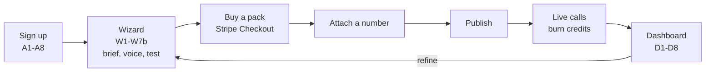

Under 15 minutes from A1 to E is the product promise. Everything slow — prompt generation, number
provisioning, knowledge ingestion — is a background job with an SSE progress channel, never a
blocking request.

---

## 2. Deployment topology

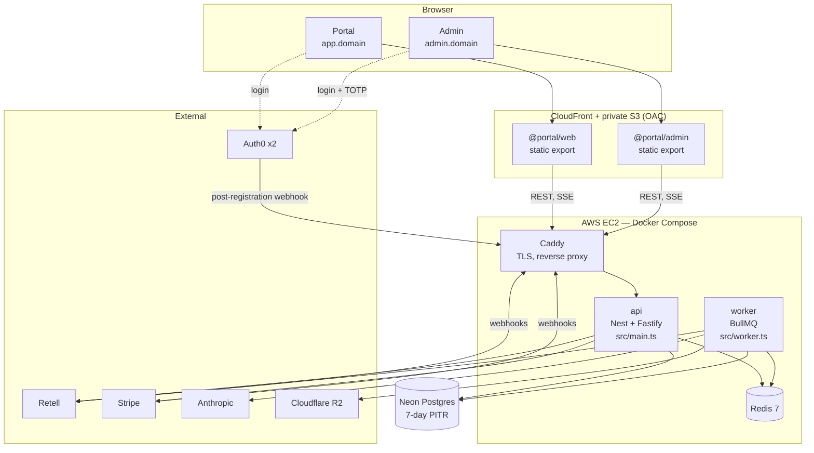

**Why the frontend and backend are hosted differently.** The two apps compile to static files —
every screen is behind a login, so there is nothing for a server to render that the browser cannot
fetch itself. The backend is the opposite: a long-lived process that holds a Redis connection, runs a
BullMQ worker, and must accept webhooks on a stable hostname. A CDN over a private bucket gives the
first, EC2 gives the second ([ADR 0008](decisions/0008-frontend-hosting-s3-cloudfront.md),
[ADR 0004](decisions/0004-backend-hosting-aws-ec2.md)).

**Why webhooks and SSE bypass the CDN.** A signature must be verified on the *raw* body, and a CDN
that re-encodes or buffers breaks both that and a long-lived SSE stream. Retell and Stripe point at
`api.<domain>` directly; CloudFront never sees them.

**Why Redis is a container on the same box, not Upstash.** BullMQ needs blocking TCP commands
(`BRPOPLPUSH`, `BZPOPMIN`). Upstash's HTTP interface cannot express them, so it cannot run the
queue at all. A compose-internal Redis on the same instance also puts the inbound-authorisation
path — the one with a p95 budget of 300 ms — on a loopback hop rather than a network round trip.

**Why Neon and not RDS.** Branch-per-environment and 7-day PITR out of the box (§17), with no
instance to patch. The trade is that Postgres is off-box, so every request pays a network hop —
which is exactly why the inbound hot path never touches Postgres synchronously (§9 below).

---

## 3. Repo layout and why it is split this way

The top-level split is **by deploy target**, not by language or by layer:

```
frontend/   → S3 + CloudFront  web, admin, ui, api-client
backend/    → EC2              api (+ worker), db
shared/     → neither          schemas, config
templates/  → data             agent templates as JSON
infra/      → build and ops    Dockerfile, compose, Auth0 actions, doctor
```

The rule this encodes: **you can tell where a file runs by its path.** A dependency that crosses
from `backend/` into `frontend/` is a mistake you can see in a diff without reading the code.
`shared/` is the only thing both sides import, and it is deliberately tiny — zod schemas, enums,
error codes, and tsconfig/eslint/tailwind bases. `@portal/schemas` depends on `zod` and nothing
else, so pulling it into the browser costs nothing.

**One image, two entrypoints.** `backend/api` builds once and runs as two compose services:
`src/main.ts` binds HTTP, `src/worker.ts` registers BullMQ processors and schedulers. They import
*the same* `modules/*/service.ts` files. A controller and a job processor calling different code
paths to do the same thing is how metering bugs are born, so they don't.

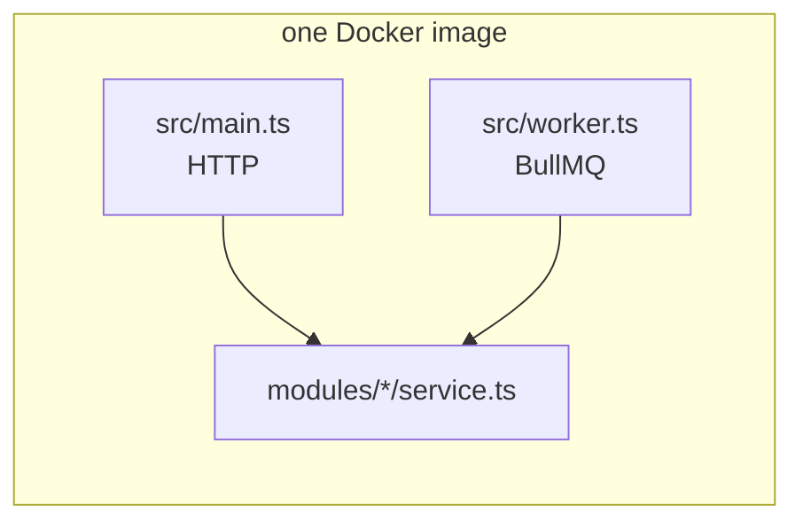

**Why NestJS rather than plain Fastify.** The spec names it, and the DI container earns its keep
here specifically because of the two entrypoints: the same provider graph boots in both processes
with no wiring duplicated. Plain Fastify was considered and rejected in
[ADR 0001](decisions/0001-tech-stack.md) — less ceremony, but it would have meant hand-rolling the
module graph twice.

**Why Prisma rather than Drizzle.** Also the spec. Drizzle's SQL-first migrations would honestly
have suited the hand-written RLS policies, grants and triggers better; the compromise is that those
live as hand-written SQL *inside* Prisma migrations
(`20260914044100_rls_roles_append_only`), which works fine and keeps one migration runner.

---

## 4. Request lifecycle: auth, workspace, RLS

Every customer request carries two headers:

```
Authorization: Bearer <jwt>
X-Workspace-Id: <uuid>
```

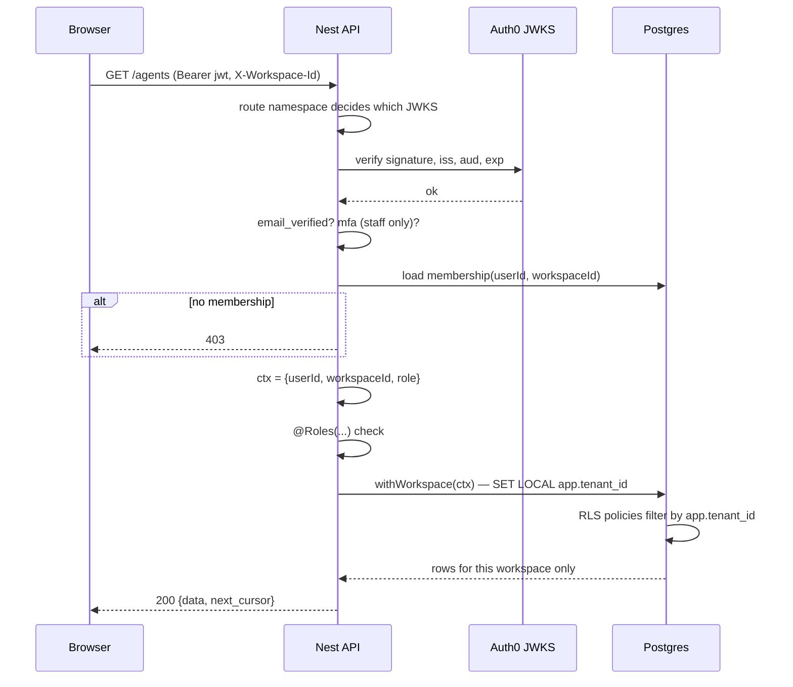

**Why the namespace is chosen by the route path and never by the token.** There are two Auth0
tenants ([ADR 0002](decisions/0002-auth-provider-auth0.md)): customers, and staff (Google Workspace
domain + mandatory TOTP). `/admin/*` is verified against the *staff* JWKS only. A customer token
presented to a staff route fails on `iss` before any handler runs — there is no code path where a
customer token can be "upgraded" by claims, because the claims are never consulted to pick the
verifier. On boot the API asserts the two issuers differ, so a misconfiguration that collapses them
into one tenant fails to start rather than silently granting staff access.

**Why two Auth0 tenants instead of one with roles.** A role is a row someone can edit. A separate
tenant with a domain restriction and mandatory MFA is a boundary that survives a mistake in the
role table. Staff access to customer data is the highest-blast-radius thing in the product.

**Why `workspace` in HTTP and `tenant_id` in the database.** The product word is *workspace*; the
spec's schema (§15) says `tenant_id` and so does every foreign key. Renaming either one would mean
fighting a source of truth. The translation happens in exactly one place, `WorkspaceGuard`, and
nowhere else — `ctx.workspaceId` goes in, `app.tenant_id` comes out.

**Routes are authenticated by default.** `@Public()` opts out, `@NoWorkspace()` skips the workspace
lookup, `@Roles(...)` / `@StaffRoles(...)` enforce the §6.1 and admin §2.2 matrices. Default-deny
means a forgotten decorator produces a 401, not a leak.

---

## 5. The two doors to Postgres

This is the single most important invariant in the backend
([ADR 0006](decisions/0006-tenancy-rls-and-append-only.md)).

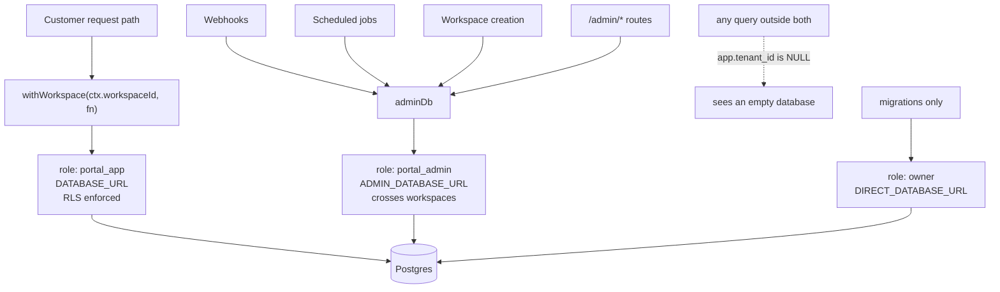

**Why `SET LOCAL` and not a session variable.** `withWorkspace` sets `app.tenant_id` as a
*transaction-local* GUC (`set_config(..., true)`), inside `$transaction`. The setting dies with the
transaction. With a connection pool, a session-scoped setting would let workspace A's context leak
onto workspace B's next request through a recycled connection — a bug that would be intermittent,
production-only, and catastrophic. Transaction scope makes it impossible by construction.

**Why the failure mode is "empty" rather than "error".** Every RLS policy compares against
`app.current_tenant_id()`. With nothing set, the comparison is against NULL, which is never true,
so the query returns zero rows. A developer who forgets `withWorkspace` gets an empty list in
development — loud enough to notice immediately, and safe if it ever escapes. The alternative
(no RLS, trust the `where` clause) fails the other way: silently correct in dev, silently
cross-tenant in prod.

**Why `adminDb` exists at all.** Three cases genuinely cannot know the workspace in advance:
a webhook (the workspace is only discoverable *after* the payload is parsed and verified), a
scheduled job that sweeps every workspace, and workspace creation itself. Pretending otherwise
would mean either disabling RLS or inventing a fake tenant context — both worse than one named,
auditable second role.

**Why `assertRlsEnforced()` blocks boot.** RLS does not apply to superusers or to table owners.
If `DATABASE_URL` were ever pointed at the owner role — an easy copy-paste in a hurry — every
policy in the database would silently stop applying and nothing would look wrong. So before the API
or worker binds anything, it checks that its connection is a `portal_app` member and is neither a
superuser nor a table owner, and refuses to start otherwise. A refusal to boot is the cheapest
possible failure for this class of mistake.

**Why history is append-only, enforced twice.** `credit_ledger`, `audit_log` and `staff_audit_log`
carry both a `REVOKE UPDATE, DELETE` from the app role *and* a
`BEFORE UPDATE OR DELETE ... RAISE EXCEPTION` trigger. The grant stops the application; the trigger
stops everything, including a `BYPASSRLS` connection and including me at 2am with psql open.
Reversals are new negative rows.

Two consequences, both deliberate:

- A workspace with ledger history **cannot be hard-deleted** — the cascade hits the trigger. The §17
  delete request is therefore an *anonymisation* job, not a `DELETE`. This is the correct outcome:
  financial history must outlive the account.
- `TRUNCATE` is deliberately *not* covered by the trigger, so `pnpm db:reset` still works locally.

---

## 6. Data model

Sixty-odd tables. Two clusters matter for correctness; the rest is CRUD.

The backend is **47 Prisma models**. They fall into six clusters, and almost every one of them
hangs off `tenants` — that is what makes a single RLS predicate on `tenant_id` sufficient.

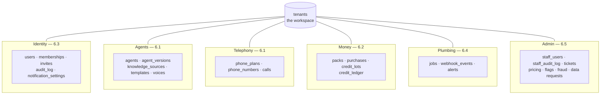

Three tables are **append-only** and appear in bold below wherever they occur: `credit_ledger`,
`audit_log`, `staff_audit_log`. Seventeen more are **config tables with no foreign keys at all**
(§6.6) — they are read through `GET /pricing` and `GET /flags` and versioned rather than mutated.

### 6.1 Agents, versions, numbers, calls

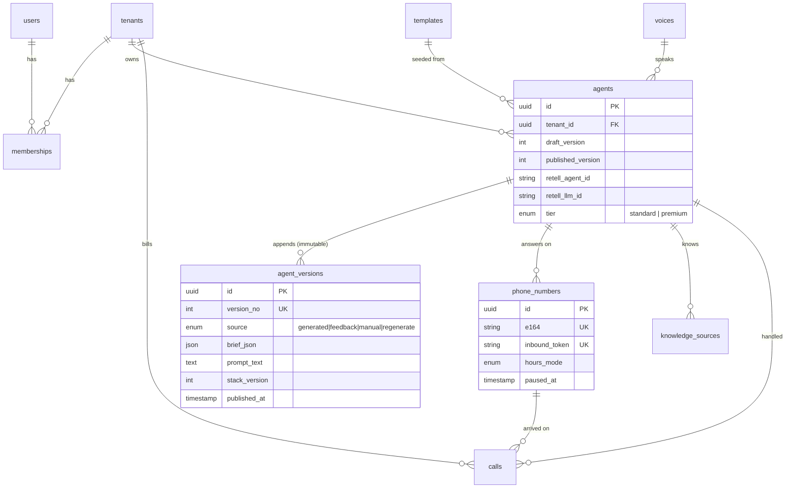

`agents.published_version` is the pointer a live number follows. `draft_version` is what the wizard
is editing. Nothing is ever updated in place in `agent_versions` — every generation, feedback patch
or manual edit appends a row with a new `version_no`, which is what makes "roll back to v3" a
pointer move rather than a reconstruction.

### 6.2 The money cluster

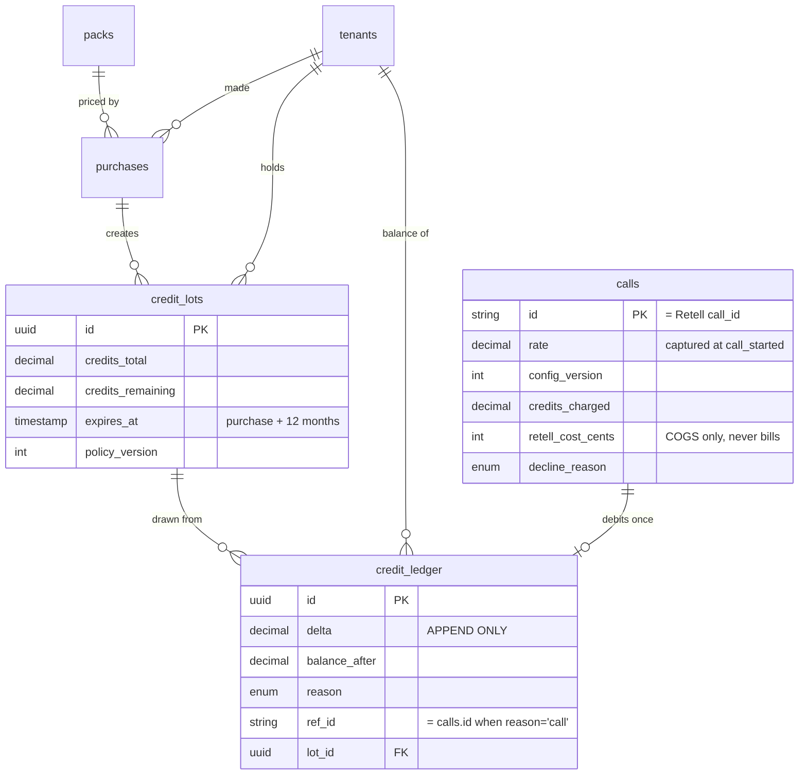

Three details in there are load-bearing:

**`calls.id` is the Retell `call_id`.** Not a surrogate key. That is what makes the ledger debit
idempotent: a partial unique index on `credit_ledger (ref_id) WHERE reason = 'call'` means a
replayed `call_ended` webhook **collides at the database level** instead of billing twice. The
guard is in Postgres, not in application logic, because application logic runs twice under a race
and a unique index does not. Declined calls never reach Retell, so they carry a synthetic
`dec_<uuid>` id.

**`calls.rate` and `calls.config_version` are captured at `call_started`.** If pricing changed
mid-call, the call bills at the rate that was current when it began. Reading the rate at
`call_ended` would make an admin price change retroactively re-bill calls already in flight.

**`retell_cost_cents` sits next to `credits_charged` and never touches it.** One is our revenue
side, one is our COGS side. Keeping them in the same row makes margin per call a single query;
keeping them in different columns makes it impossible to accidentally bill the customer our cost.

---

### 6.3 Identity, membership and history

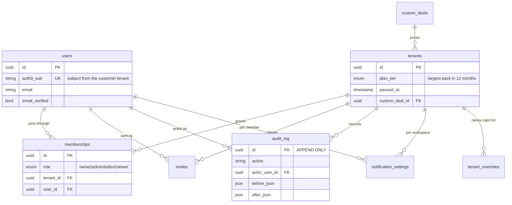

`memberships` is the many-to-many that makes a user's identity independent of any workspace, and it
carries the §6.1 role. Exactly one `owner` per workspace is a rule the `workspaces` service enforces,
not a constraint — a partial unique index would block the ownership *transfer* that the spec requires.

`tenants.custom_deal_id` pointing at `custom_deals`, which itself has a `tenant_id`, looks circular
and is not: the deal is authored against a workspace by staff (admin §8), then attached once agreed.

### 6.4 Knowledge, plans and plumbing

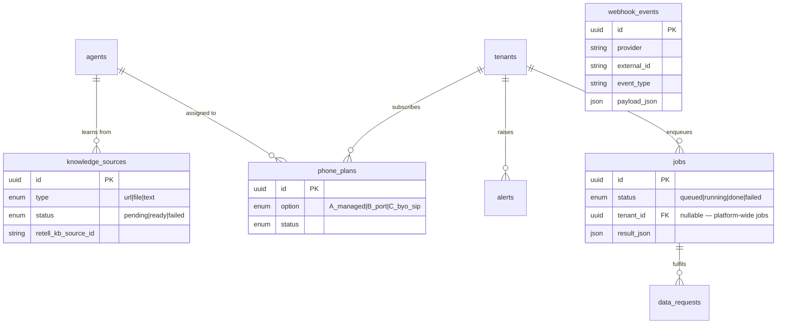

`webhook_events` deliberately has **no foreign key to anything**. It is written before the payload
is parsed, which is the only moment at which the workspace is still unknown — the exactly-once
guard in §11 works precisely because storage happens before interpretation. Its unique key is
`(provider, external_id, event_type)`.

`jobs.tenant_id` is nullable so that platform-wide work (voice-cache refresh, lot expiry sweep) is
the same row shape as a customer's export.

### 6.5 The admin console

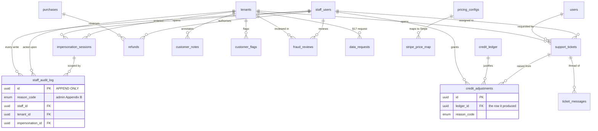

The shape worth noticing: **`credit_adjustments` does not hold an amount.** It points at the
`credit_ledger` row it caused. Staff cannot move credits except by making a ledger entry, and the
adjustment table exists only to attach a reason code and an author to it. The same applies to
`refunds` → `purchases`. This is the §14 rule — *every ledger write goes through the wallet module* —
expressed in the schema rather than trusted to reviewers.

`impersonation_sessions` links into `staff_audit_log` so that every write made while impersonating a
customer is attributable both to the staff member and to the session, which is the question asked
after an incident.

### 6.6 Config tables with no foreign keys

Seventeen tables carry no `tenant_id` and no relations. They are global, versioned, and read through
the cached config endpoints — never joined to a customer row at query time.

| Table | Read as | Why it has no FK |
| --- | --- | --- |
| `packs` | `GET /pricing` | The catalogue (§5.2). A purchase copies the numbers it needs, so changing a pack never re-prices history |
| `pricing_drafts`, `pricing_configs` | `pricing:current` | Versioned. `calls.config_version` and `credit_lots.policy_version` point *back* at a version, never forward |
| `stripe_price_map` | Checkout | The only one with a relation — to `pricing_configs`, by version |
| `agent_stack_configs` | `RetellGateway` | Tier → model/voice mapping. `agent_versions.stack_version` records which one generated a prompt |
| `retell_cost_inputs` | COGS reporting | What Retell charges us, by period |
| `templates`, `voices` | Wizard W1, W3 | `voices` is a read-only cache refreshed from `list-voices` by a job |
| `promo_codes` | Checkout | Applied at purchase; the discount lands in `purchases`, not in a join |
| `feature_flags`, `kill_switches` | `flags:*` | Toggled without a deploy; the portal re-reads within 60 s |
| `blocklists` | Inbound path | Denormalised into `num:{e164}` in Redis — the 300 ms path never reads this table |
| `staff_role_limits` | Admin guards | Per-role limits as data (admin §2.2), seeded by `pnpm db:seed` |
| `canned_responses`, `email_templates`, `announcements` | Support, email | Content, not customer data |

**The rule this encodes:** anything that can change price, behaviour or capability is a *versioned
row*, and anything that consumed it stores the version it saw. That is what makes "why was this call
billed at that rate?" answerable a year later.

## 7. Agent lifecycle and prompt generation

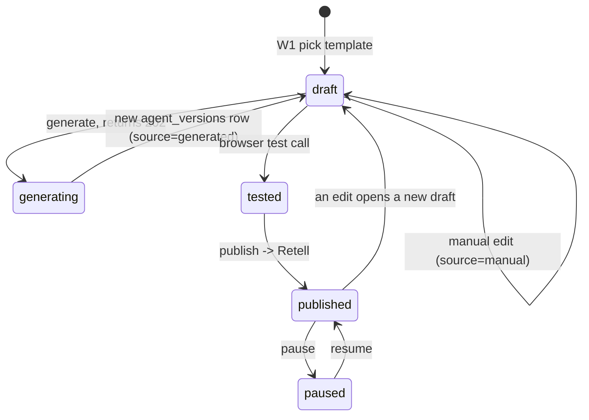

The generation call itself:

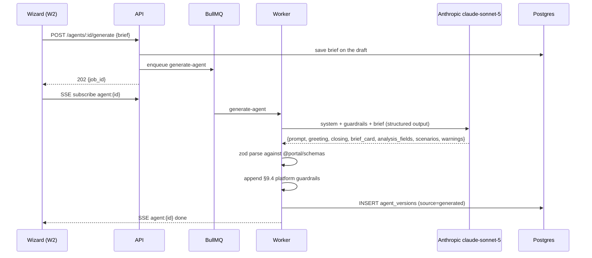

**Why generation is a job and not a request.** It takes several seconds and the wizard must stay
responsive. `202 {job_id}` plus SSE, with `GET /jobs/:id` every 3 s as a fallback, is the pattern
for every long operation in the API (§16) — generation, number provisioning, knowledge ingestion,
exports. One pattern, learned once.

**Why the generation LLM is not the in-call LLM.** They are different models solving different
problems and it is easy to conflate them. The **generation** LLM runs two or three times in an
agent's entire life, from a background job, and its output is text we store. The **in-call** LLM
runs on every turn of every call, inside Retell, with a latency budget measured in hundreds of
milliseconds. The first is Anthropic `claude-sonnet-5` and is ours
([ADR 0009](decisions/0009-llm-provider-anthropic.md)); the second is Retell's to configure and is
still open (§20 item 3).

**Why Anthropic for generation.** Key in hand on 15 Sep, and no measured reason to prefer anything
else. ADR 0007 had moved this to OpenAI for a day on owner preference plus a "family alignment"
hypothesis — writer and executor in the same model family — that ADR 0009 sets aside as
unmeasured and weak: a prompt is text, not a model-specific format, and vendor count is a tie
because the in-call model runs on Retell's keys. Both ADRs are explicit that the choice was made
without a benchmark, that the benchmark is scheduled for D2, and that the provider lives behind
`modules/prompting/providers/` so reversing it is one file — which the reversal itself just
demonstrated. Cost did not enter into it: a generation call is cents against a $49 Starter pack.
Sonnet rather than Opus because the §9.4 guardrails are appended by the worker after generation
(see the sequence above), so the model's job is plain structured drafting, and Sonnet meets the
10 s p95 exit check without effort tuning.

**Why not Retell Conductor.** Conductor is Retell's dashboard copilot. It is not in the SDK, it is
capped at 30 messages per person and 200 per organisation per day, and its stated golden rule is
that it never changes an agent without a human approving a diff. Every one of those is
disqualifying for an automated `POST /agents/:id/generate` serving every customer. Recorded in
full in ADR 0007's alternatives. It is still worth using by hand during the D2 benchmark to learn
from how it structures prompts.

**Why guardrails are appended server-side and cannot be removed.** §9.4 guardrails are what stop a
customer's agent from making promises the business cannot keep. They are appended after the model
returns, not requested from it, because a model can be talked out of including something and a
string concatenation cannot. Feedback that conflicts with a guardrail returns `changes: []` plus an
explanation rather than silently declining to apply it.

---

## 8. Publishing, and the Retell projection

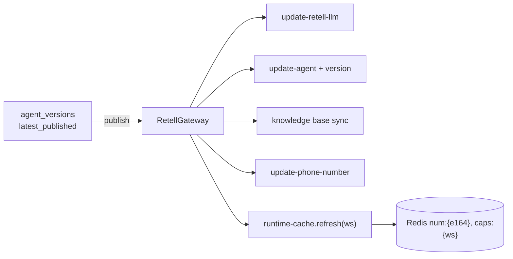

Postgres is the source of truth; the Retell objects are a **projection** of it. One
`retell_llm_id` and one `retell_agent_id` per agent, plus numbers and knowledge bases. Numbers
always run `latest_published` — drafts are reachable only by passing an explicit `agent_version`
to `create-web-call`, which is how the wizard tests an unpublished draft without ever exposing it
to a real caller.

Two facts from the spike shape this ([ADR 0003 §7](decisions/0003-retell-findings.md)). A number
bound without `agent_version` runs `latest`, **drafts included**, so the gateway always binds with
`agent_version: "latest_published"`; publishing then needs no `update-phone-number`. And a
published Retell version is immutable (`update-agent` returns 422), so every edit starts with
`create-agent-version(base = published)`; the LLM is versioned with the agent, and "roll back" is a
new version from an old base, published.

**Why every Retell call goes through one gateway.** `RetellGateway` owns the tier → model/voice
mapping, webhook URL construction, and retry/backoff. Concentrating it means the P0 findings about
Retell's actual behaviour land in one file, tier changes are a mapping edit, and — if Retell is
ever replaced — the blast radius is known in advance. It is the same isolation argument as
`modules/prompting/providers/`, applied to the vendor we are most dependent on.

**Why `runtime-cache.refresh(workspaceId)` is called from every mutating path.** Pause/resume, plan
change, number change, publish, ledger write. The inbound hot path reads Redis and only Redis
(§9), so a stale cache is not a display bug — it is a call answered by a paused agent, or a call
declined for a workspace that just topped up. A periodic full refresh backstops any path that
forgets.

---

## 9. Inbound call authorisation — the hot path

`POST /webhooks/retell/inbound/:number_token`. Retell times out at **10 s** and retries 3×. Our
budget is **p95 < 300 ms**. This is the only endpoint in the system with a latency SLO, and it is
the reason several other decisions look the way they do.

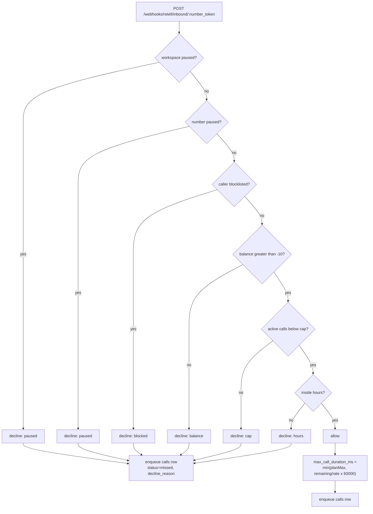

**Why this path never touches Postgres.** Neon is off-box. A single round trip plus a query is a
meaningful fraction of a 300 ms budget, and six ordered checks would be several. Everything the six
checks need is denormalised into Redis — `num:{e164}`, `bal:{ws}`, `active:{ws}`, `caps:{ws}` — on
loopback. The cost of that choice is cache-freshness discipline, which is paid by
`runtime-cache.refresh()` on every mutating path.

**Why both outcomes write the `calls` row via an enqueued job, never inline.** A synchronous insert
would put Postgres back on the hot path and hand Retell a 500 whenever the database hiccuped. The
decline path matters as much as the allow path: declined rows carry
`decline_reason ∈ {balance, cap, blocked, hours, paused}` and surface in the dashboard as
"Missed" — which is how a customer discovers they ran out of credits at 9am rather than at
month-end.

**Why the checks are ordered the way they are.** Cheapest and most absolute first. A paused
workspace is one field; a blocklist check is a set membership; an hours rule involves timezone
arithmetic. Ordering also decides which `decline_reason` a caller gets when several apply, and the
most actionable reason should win.

**Why `max_call_duration_ms` is computed here.** `min(planMax, remainingCredits/rate × 60000)`.
Retell enforces it, so a customer with 3 credits left gets a call that ends cleanly at three
minutes instead of one that runs up an overdraft. Combined with the 10-credit grace overdraft, the
result is that a call is never cut mid-sentence *and* never runs away.

**Redis down: fail open, fast and bounded** ([ADR 0003 §12](decisions/0003-retell-findings.md)).
The spike showed what each answer buys: a hung webhook is ~30 s of ringing and a missed call, a
fast 5xx is three retries and then the bound agent anyway, `reject` is a busy tone. So every Redis
read here runs under a 150 ms budget and on failure the handler answers `200 {}` at once — the
number's `latest_published` agent takes the call with the plan maximum baked into its
`max_call_duration_ms`, `call_ended` still bills through Postgres, and what is lost for the outage
window is only the authorisation. Alert on the first fail-open; `INBOUND_REDIS_DOWN_POLICY=closed`
exists for an operator who prefers busy tones during an incident.

---

## 10. Metering and the money path

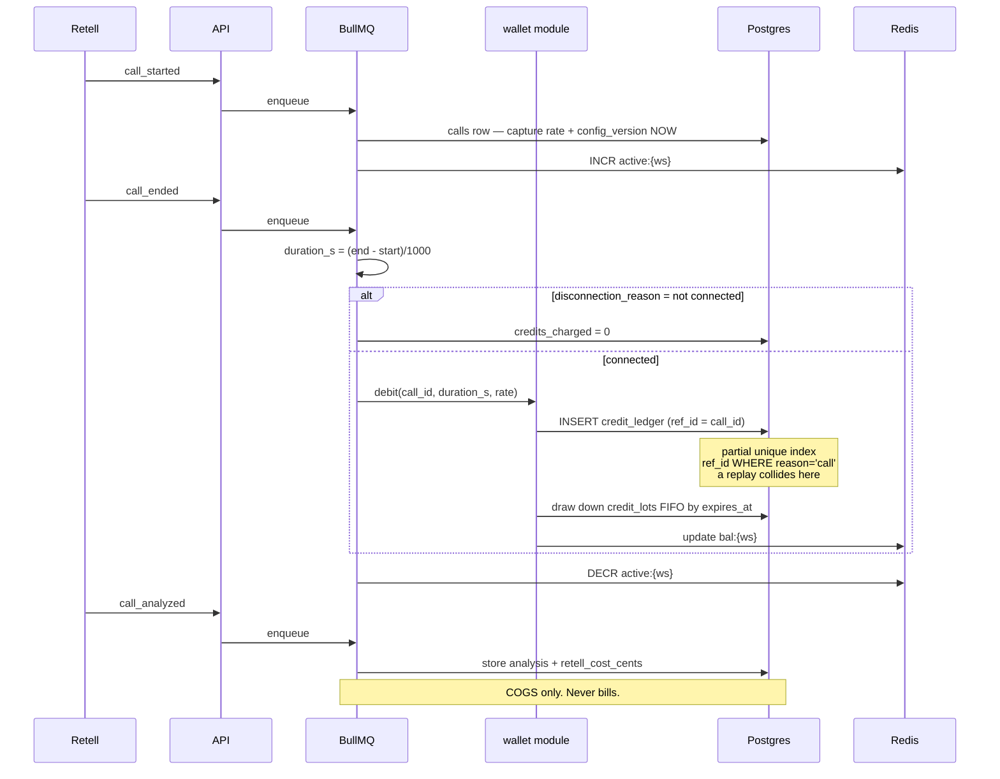

The rules, stated once so they can be checked against the code:

- **`call_ended` is the only event that moves credits.** `call_analyzed` stores analysis and
  `retell_cost_cents` and never bills. Two events that both touch money is how you get
  double-billing under retry.
- `duration_s = (end_timestamp − start_timestamp)/1000`. If `disconnection_reason` indicates the
  call never connected (dial failed, no answer, busy), the charge is **0** — the customer does not
  pay for a phone ringing.
- `credits = duration_s/60 × rate(tier)`, rounded to 0.01. Standard is 1 credit/min, Premium 1.5.
- **Every ledger write goes through the `wallet` module.** No direct `credit_ledger` inserts
  anywhere else, ever. One module means one place to audit, one place to test, and one place where
  the FIFO lot drawdown lives.
- Balance = Σ `credit_ledger.delta`, cached at `bal:{ws}`, and **rebuilt from the ledger on
  mismatch**. The cache is an optimisation; the ledger is the truth. Lots are consumed FIFO by
  `expires_at` so the credits closest to expiring burn first — which is both what the customer
  would choose and what keeps unearned revenue falling off the books predictably.

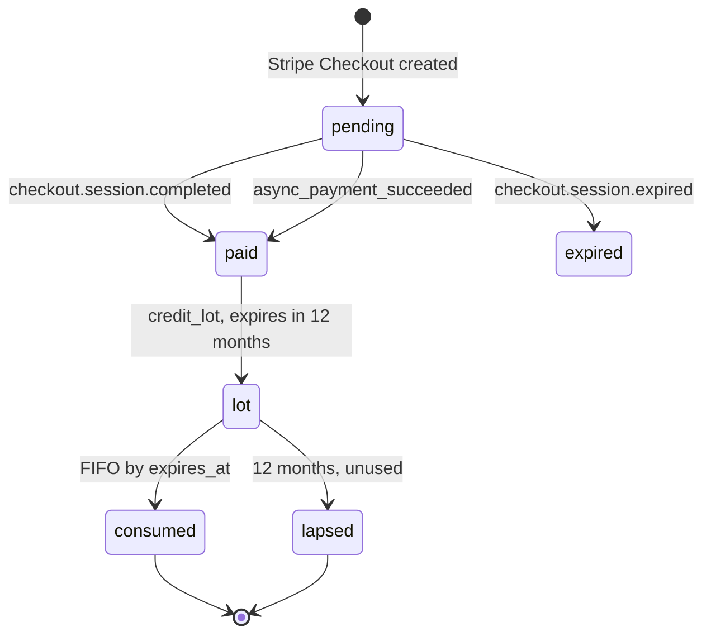

---

## 11. Webhooks, exactly once

Four inbound webhook routes, no JWT on any of them: `/webhooks/retell`,
`/webhooks/retell/inbound/:number_token`, `/webhooks/stripe`, `/webhooks/auth`.

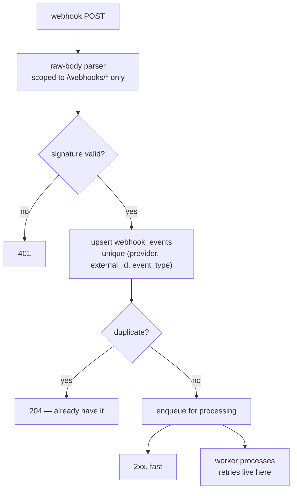

**Why the raw-body parser is scoped to `/webhooks/*` only.** Signature verification must run
against the exact bytes sent. Disabling JSON parsing globally to achieve that would make every
other route in the application worse; scoping it to the webhook prefix costs one line of Fastify
configuration.

**Why store first, then process.** Once the event is durably in `webhook_events`, we owe Retell
nothing further — so we return 2xx immediately and do the work in BullMQ where retries are ours to
control, with backoff and a dead-letter queue. **Never return 5xx to Retell after the event is
stored**: that would make Retell retry an event we already have, and a provider's retry policy is a
worse queue than the one we run.

**Why `(provider, external_id, event_type)` and not just `external_id`.** One Retell call produces
`call_started`, `call_ended` and `call_analyzed` all carrying the same `call_id`. The event type is
part of the identity.

**Why the duplicate returns 204.** It is a successful outcome, not an error. A provider replaying
an event is normal operation, and logging it as a failure trains you to ignore the alert.

---

## 12. Jobs, queues and schedulers

BullMQ on the same Redis. Processors and Job Schedulers are registered **idempotently on boot**, so
a redeploy or a second worker does not double-register a schedule.

| Kind | Examples | Why it is a job |
| --- | --- | --- |
| Long, user-visible | `generate-agent`, number provisioning, knowledge ingestion, export | Wizard must stay responsive — `202 {job_id}` + SSE |
| Webhook processing | Retell + Stripe event handlers | Retries under our control, not the provider's |
| Write-behind | the `calls` row from the inbound path | Keeps Postgres off a 300 ms hot path |
| Scheduled | number rental (15 cr/month on the purchase anniversary), extra-KB charges, lot expiry, low-balance alerts, `voice-cache` refresh, periodic runtime-cache refresh | Nobody is holding a request open |

Jobs use `adminDb` — they sweep across workspaces by design — or `withWorkspace(workspaceId, ...)`
when they are operating on exactly one, which is preferred wherever it applies because it keeps RLS
in play.

---

## 13. Configuration as data

Pricing, feature flags, kill switches, templates and the agent stack live in **versioned tables**,
read through `GET /pricing` and `GET /flags`.

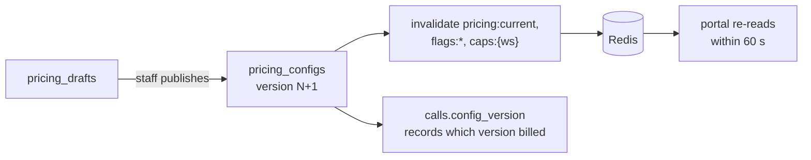

**Never hard-code a price, rate, cap or model id.** The reason is not flexibility for its own sake:
it is that `calls.config_version` and `credit_lots.policy_version` let you answer "why was this
call billed at that rate?" a year later, and that answer only exists if the rate came from a
versioned row. A constant in the code makes every historical billing dispute unanswerable.

Publishing a config invalidates `pricing:current`, `flags:*` and `caps:{ws}`; the portal re-reads
within 60 s. Kill switches exist so a staff member can disable a feature without a deploy — which,
with one developer, is the difference between a two-minute mitigation and a twenty-minute one.

---

## 14. Admin console and staff access

A separate Next.js app on `admin.<domain>`, a separate Auth0 tenant, and `/admin/*` routes that
accept staff JWTs only. A staff JWT without the `https://portal/mfa` claim is rejected outright.

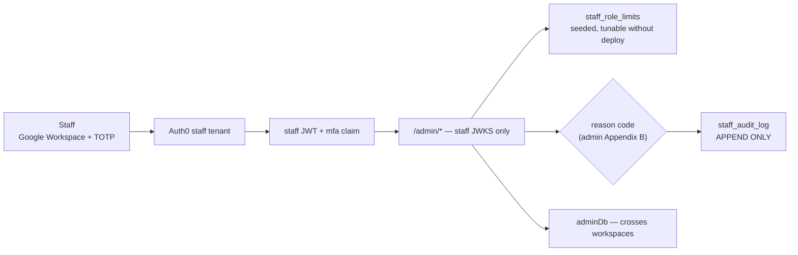

**Why every customer-affecting staff write needs a reason code and an audit row.** Staff can adjust
credits, issue refunds, override caps and impersonate. Each of those is indistinguishable from
fraud without a recorded reason, and `staff_audit_log` is append-only for the same reason
`credit_ledger` is. Role limits live in `staff_role_limits` as data so they can be tuned without a
deploy, and they are enforced **server-side** — a disabled button is a hint, not a control.

---

## 15. Observability, secrets, environments

OpenTelemetry → Grafana Cloud, Sentry for exceptions, Slack for alerts. Recordings stay on Retell
URLs and are proxied with signed 1-hour URLs; only exports land in Cloudflare R2.

**Why recordings are proxied rather than copied.** Copying them would mean storing customer call
audio ourselves, which is a materially larger privacy and retention obligation for no product
benefit. A signed 1-hour URL gives the customer access without making us the custodian.

Secrets live in **AWS SSM Parameter Store**, nothing in the repo. SIP credentials get one extra
layer — envelope encryption with an AWS KMS data key (AES-256-GCM) — because they are the one
credential that lets someone else place calls billed to our customer.

Environments are `dev`, `staging`, `prod`, with one Retell API key and one webhook URL set per
environment, and Retell test agents prefixed `dev-`. Stripe test and live keys never mix.
`pnpm doctor` reports what is unset and what is unreachable, so a broken environment says so in one
command rather than through a confusing runtime error.

Tests are **required** — not best-effort — for metering, ledger idempotency, webhook exactly-once,
inbound decline paths, and RLS cross-tenant isolation. That list is exactly the set of failures that
are silent, expensive, and discovered by customers rather than by us.

---

## 16. Decision log — the why, in one table

| Decision | Chosen | Why | Rejected, and why | ADR |
| --- | --- | --- | --- | --- |
| Backend framework | NestJS on Fastify | Spec names it; DI graph boots identically in both entrypoints | Plain Fastify (less ceremony, but module graph duplicated); FastAPI (would fork the shared zod layer) | [0001](decisions/0001-tech-stack.md) |
| ORM | Prisma | Spec names it; one migration runner for hand-written RLS SQL | Drizzle (better SQL-first migrations, but off-spec) | [0001](decisions/0001-tech-stack.md) |
| API surface | Nest, not Next route handlers | Route handlers break SSE and cannot host BullMQ | Next-only backend | [0001](decisions/0001-tech-stack.md) |
| Auth | Auth0, two tenants; `@auth0/auth0-spa-js` (PKCE) in the browser | Staff boundary survives a mistake in a role table; MFA and domain restriction are tenant-level. PKCE keeps every secret out of the frontend | One tenant with roles; Clerk (superseded); `@auth0/nextjs-auth0` server sessions (needs a server we no longer run) | [0002](decisions/0002-auth-provider-auth0.md), [0008](decisions/0008-frontend-hosting-s3-cloudfront.md) |
| Backend hosting | AWS EC2 + Docker Compose | Long-lived worker, TCP Redis, stable webhook hostname | Railway (superseded); serverless (no BullMQ, no SSE) | [0004](decisions/0004-backend-hosting-aws-ec2.md) |
| Frontend hosting | S3 (private) + CloudFront (OAC) + ACM, static export | Every screen is behind a login, so SSR buys nothing; no server means no client secret in the frontend and no AWS role for the build | Amplify (largest third-party grant, two extra IAM roles, adapter lag); Next on the EC2 box (contends with the 300 ms inbound path); OpenNext on Lambda; Vercel | [0008](decisions/0008-frontend-hosting-s3-cloudfront.md) |
| Redis | Redis 7 container on the backend box | BullMQ needs blocking TCP; loopback keeps the 300 ms inbound budget | Upstash — HTTP Redis cannot run BullMQ at all | [0001](decisions/0001-tech-stack.md) |
| Database | Neon Postgres | Branch-per-environment, 7-day PITR, no instance to patch | RDS (more ops for no gain at this size) | [0001](decisions/0001-tech-stack.md) |
| Tenancy | Two roles + RLS + append-only triggers | Second guard under the app; failure mode is "see nothing"; history survives even a BYPASSRLS connection | App-level `where tenant_id` only (silently cross-tenant in prod); schema-per-tenant (migration cost) | [0006](decisions/0006-tenancy-rls-and-append-only.md) |
| Generation LLM | Anthropic `claude-sonnet-5`, structured output | Key in hand; the family-alignment case for OpenAI was unmeasured and weak; Sonnet tier because the §9.4 guardrails are appended by code and Sonnet meets the 10 s p95 without tuning; behind a provider interface so it is one file to reverse — as the 0007 → 0009 reversal showed | Anthropic `claude-opus-5` (unused headroom, needs latency tuning; D2 benchmarks it); OpenAI `gpt-5` (ADR 0007 — no evidence against, key not in hand); both per template (ambiguous `stack_version`); **Retell Conductor** (dashboard-only, 200 msg/org/day, requires human approval) | [0009](decisions/0009-llm-provider-anthropic.md) |
| Voice platform | Retell behind `RetellGateway` | Single import site bounds the blast radius and concentrates the P0 findings | Direct SDK use across modules | [0001](decisions/0001-tech-stack.md) |
| Ledger idempotency | Partial unique index on `(ref_id) WHERE reason='call'` | A database constraint survives a race; application logic does not | Application-level "check then insert" | [0006](decisions/0006-tenancy-rls-and-append-only.md) |
| Inbound authorisation | Redis-only, six ordered checks | 300 ms p95 against a 10 s Retell timeout; Neon is off-box | Synchronous Postgres reads | §13.9 |
| Long operations | `202 {job_id}` + SSE, `GET /jobs/:id` fallback | One pattern for generation, provisioning, ingestion, exports | Blocking requests; polling only | §16 |
| SSE client | `@microsoft/fetch-event-source` | `EventSource` cannot send `Authorization` or `X-Workspace-Id` | Native `EventSource`; WebSockets (more infrastructure than one-way progress needs) | [0001](decisions/0001-tech-stack.md) |
| Recordings | Proxied from Retell, signed 1-hour URLs | Avoids becoming custodian of customer call audio | Copying to R2 | §17 |

---

---

## 17. Services, access and what is provisioned

What the platform runs on, what each piece is for, and where it stands as of **14 Sep 2026 (D3)**.
Status is read from `pnpm doctor`, the Auth0 tenants and the Retell dashboard — not from the plan.
This is the one section expected to change weekly until MVP; fix it when something is provisioned.

### What we need access to right now

Four things, in the order they unblock work. Everything else in this section either already exists or
can wait.

| Ask | Why we need it | Why now | Blocked without it |
| --- | --- | --- | --- |
| ~~**OpenAI API key**~~ → **Anthropic API key** with billing — available 15 Sep 2026, needs to land in `.env` and SSM | The only LLM we call ourselves: brief → prompt (§9.3) and feedback patches (§9.6). The in-call model is Retell's ([ADR 0009](decisions/0009-llm-provider-anthropic.md)) | D5 is prompt generation | `POST /agents/:id/generate` returns nothing; W2 is a dead end; the D2 quality benchmark cannot run |
| **Neon project** — one I can create branches and roles in | The only Postgres we run. 7-day PITR is the §17 recovery requirement; branch-per-environment gives staging its own data with no second server ([ADR 0006](decisions/0006-tenancy-rls-and-append-only.md)) | Migrations, RLS, triggers and seed are done and green locally. Nothing on AWS is worth creating before the database it talks to exists | No staging environment at all |
| **AWS — scoped access, not admin** (see below) | Runs the backend: the long-lived process BullMQ, SSE and a stable webhook hostname all require ([ADR 0004](decisions/0004-backend-hosting-aws-ec2.md)), plus S3 + CloudFront for the two apps ([ADR 0008](decisions/0008-frontend-hosting-s3-cloudfront.md)) | D7–D8. Setting up IAM, SSM and the instance is a day of work that should not land on deploy day | Nothing deploys anywhere |
| **Domain** — registrar login or a delegated zone | `app.`, `admin.` and `api.` all hang off it | It costs nothing to decide and unblocks four other things | Webhooks stay on a `trycloudflare` URL that changes on restart; no Auth0 production callbacks; no ACM certificate; Caddy cannot issue TLS |

**On AWS access.** `AdministratorAccess` is not available to us, and it is not actually required —
it was only ever the fastest path. Two workable alternatives, in order of preference:

1. **Scoped setup access.** The `PowerUserAccess` managed policy (everything except IAM and
   Organizations) plus a narrow IAM slice — `iam:CreateRole`, `iam:AttachRolePolicy`, `iam:PassRole`
   restricted to the path `/voice-agent/` and governed by a permissions boundary. That is enough to
   create the instance role and the `ci` user without being able to touch anything outside the
   project's own path. This is the standard answer to "we cannot grant admin" and is what I would ask
   for.
2. **Admin creates, we consume.** Whoever holds admin creates the resources from the table below —
   it is a fixed list, not an open-ended one — and hands back an EC2 instance with the role attached,
   the `ci` access key, the four bucket names, the two distribution IDs and the KMS key id. We lose
   the ability to iterate on infrastructure, which matters on D7–D8, but nothing is blocked outright.

Either way, ask whoever sets the account up to add a **budget alert at $50/month**. Expected steady
state is well under that, so the alert is a mistake detector, not a cost control.

### AWS

| Service | What it does for us | Access it needs | Why this, and not the alternative | Status |
| --- | --- | --- | --- | --- |
| **EC2** — `t3.small` staging, `t3.medium` prod | Runs `api`, `worker`, `redis`, `caddy` via Docker Compose ([ADR 0004](decisions/0004-backend-hosting-aws-ec2.md)) | Instance role: `ssm:GetParameters` on `/voice-agent/<env>/*`, `kms:Decrypt` on the SIP key, `ssmmessages:*` for Session Manager. Security group: inbound **443 only**, no SSH port | BullMQ needs a process that never sleeps, SSE a connection that stays open, webhooks a hostname that does not change. Serverless fails all three. One box beats ECS at this scale — one compose file, and the deploy is `docker compose up -d` | **Not started** — `docker-compose.prod.yml` lands D7 |
| **Elastic IP** ×2 | Stable address for `api.<domain>` | Attached to the instance, nothing else | Retell and Stripe webhook URLs are configured once and must survive an instance replacement | **Not started** |
| **S3** ×4 (web/admin × staging/prod) | Holds the compiled Next.js static export. Bucket **private** — *Block all public access* ON ([ADR 0008](decisions/0008-frontend-hosting-s3-cloudfront.md)) | CI user: `s3:PutObject`, `s3:DeleteObject`, `s3:ListBucket` on these buckets only. CloudFront reads via OAC; no public principal, ever | A static export needs a file store, not a server. Private + OAC means the only way in is through the CDN — no second, uncached, unlogged path to the app | **Not started** — D8 |
| **CloudFront** ×2 | CDN and HTTPS for `app.<domain>` and `admin.<domain>`; reads S3 through **OAC** | CI user: `cloudfront:CreateInvalidation` on these two distributions. OAC grants the distribution `s3:GetObject` on its own bucket, conditioned on the distribution ARN | Hitting the S3 URL directly gives `Access Denied` — that is OAC working. Custom error responses map **403 and 404** → `/index.html` 200; a private bucket returns 403, not 404, which is the classic thing to get wrong | **Not started** — D8 |
| **ACM** — 1 certificate | TLS for both distributions | DNS validation on the domain's zone | **Must be requested in `us-east-1`** even though the rest of the account is `ca-central-1` — CloudFront reads certificates only from N. Virginia. Caddy on EC2 is unaffected; it keeps issuing its own Let's Encrypt certificate for `api.<domain>` | **Blocked** on the domain |
| **SSM Parameter Store** | The only home for secrets: `SecureString` under `/voice-agent/<env>/*` (§17) | CI user: `ssm:PutParameter` on that prefix. Instance role: `ssm:GetParameters`. The frontend build needs none — a static export has no server-side secrets. Nobody gets `/voice-agent/*` unscoped | Free at our volume, IAM-scoped per environment prefix, KMS-encrypted at rest. Secrets Manager adds rotation and cost we do not need yet | **Not started** — local `.env` only |
| **SSM Session Manager** | Deploys and shell access with no SSH key and no open port 22 | Instance role `ssmmessages:*`; CI user `ssm:SendCommand` scoped by instance tag | A leaked SSH key is a permanent credential; a Session Manager session is IAM-authenticated, logged and revocable | **Not started** |
| **KMS** — one customer-managed key | Wraps the data key for SIP credentials (AES-256-GCM envelope) → `SIP_CREDENTIALS_KMS_KEY_ID` | `kms:GenerateDataKey` + `kms:Decrypt` for the `api` role **only**; the worker never decrypts SIP secrets | SIP credentials let someone place calls billed to our customer. Envelope encryption means the database holds nothing usable even under a full dump. Everything else in SSM is already KMS-encrypted with the AWS-managed key | **Placeholder** — `.env` holds a dummy id; `pnpm doctor` marks it optional until D8 |
| **IAM** — 1 user, 1 role | `ci` user (GitHub Actions): `ssm:PutParameter`, `ssm:SendCommand`, S3 write on the four buckets, `cloudfront:CreateInvalidation`. `ec2-api` instance role. That is the whole account | Least privilege, scoped by `/voice-agent/<env>/` prefix and by instance tag; no `*` resources | The CI credential is the one that lives in a third party. It must be able to deploy and nothing else | **Not started** |
| **Route 53** *(optional)* | DNS for `<domain>` | Hosted zone; CloudFront needs an alias record and Caddy an A record | Only if the domain is registered with AWS. If DNS stays at Cloudflare — where the tunnel and R2 already are — skip it | **Blocked** on the domain |
| **CloudWatch** *(minimal)* | EC2 status-check alarm → Slack | Default instance metrics; one alarm | Application telemetry goes to Grafana Cloud over OTel. CloudWatch is only for "the box is gone" | **Not started** |

```mermaid
flowchart LR
    GH["GitHub<br/>repo + Actions + GHCR"]
    subgraph AWS["AWS account"]
        IAMCI["IAM user: ci"]
        SSM[("SSM Parameter Store<br/>/voice-agent/env/*")]
        KMS["KMS key<br/>SIP data key"]
        subgraph EC2["EC2 + Elastic IP"]
            ROLE["instance role: ec2-api"]
            API["api"]
            WRK["worker"]
        end
        S3B[("S3 x4<br/>private, OAC only")]
        CF["CloudFront x2<br/>ACM cert from us-east-1"]
    end
    GH -->|"ci: ssm:PutParameter"| SSM
    GH -->|"ci: ssm:SendCommand<br/>compose pull and up"| EC2
    GH -->|"ci: s3 sync + invalidation"| S3B
    EC2 -->|"pull image"| GH
    ROLE -->|"ssm:GetParameters"| SSM
    ROLE -->|"kms:Decrypt<br/>api only"| KMS
    CF -->|"OAC: s3:GetObject"| S3B
```

Every arrow is one IAM statement. There is no path from the frontend to KMS, none from the worker to
SIP secrets, and none from CI to the running database — CI can put a secret, sync files and trigger a
deploy, and that is all. The whole account is **one IAM user and one instance role**; the frontend
build needs no AWS role at all, because a static export has no server-side secrets to fetch.

**What we deliberately do not use from AWS**

| Not used | We use instead | Reason |
| --- | --- | --- |
| RDS | **Neon Postgres** | Branch-per-environment and 7-day PITR out of the box; no instance to patch (§17) |
| S3 *for exports* | Cloudflare R2 | Zero egress, and exports are pure egress. S3 *is* used for the frontend — a CDN-fronted static site is cached at the edge, so egress never hits the bucket |
| ECR | GitHub Container Registry | The image is built by GitHub Actions; pushing to GHCR needs no AWS credential in the build |
| ElastiCache | Redis 7 container on the EC2 box | The inbound path has a 300 ms p95 budget; loopback beats a network hop, and ElastiCache costs more than the instance |
| Cognito | Auth0 ×2 | Two-tenant staff/customer split, Google Workspace connection, mandatory TOTP — Cognito makes each harder ([ADR 0002](decisions/0002-auth-provider-auth0.md)) |
| Lambda / API Gateway | NestJS on EC2 | No BullMQ, no SSE, cold starts on the webhook path |
| Amplify Hosting | S3 + CloudFront | Superseded on 14 Sep — the SSR premise was circular. Full reasoning in [ADR 0008](decisions/0008-frontend-hosting-s3-cloudfront.md) |
| ACM *for the API* | Caddy on EC2 | Caddy issues and renews its own Let's Encrypt certificate for `api.<domain>`. ACM serves CloudFront only, and only from us-east-1 |

### Everything that is not AWS

| Vendor | What it does for us | Access it needs | Status |
| --- | --- | --- | --- |
| **Neon** | Postgres, 7-day PITR, one branch per environment | Owner string → `DIRECT_DATABASE_URL`; two login roles → `DATABASE_URL`, `ADMIN_DATABASE_URL` ([ADR 0006](decisions/0006-tenancy-rls-and-append-only.md)) | **Done, 14 Sep 2026.** Project `Voice Agent`, AWS us-east-2, Postgres 18.6. All three migrations, the two login roles (created in SQL, not the console, so neither inherits `neon_superuser`/BYPASSRLS) and the seed are applied; `pnpm test:e2e` passes 53/53 against it. Daily work and CI stay on local Docker Postgres 16 — the suite takes 0.7 s there against 100 s over the network. Still on the Free plan, whose history retention is under the 7 days §17 needs; Launch ($19/mo) is required before launch |
| **Retell AI** | Voice platform behind `RetellGateway`: agents, LLM objects, numbers, knowledge bases, web and phone calls, webhooks | One API key per environment; webhook secret; webhook URL → `api.<domain>/webhooks/retell` | **Live (dev).** Workspace on pay-as-you-go, key and webhook secret set, a test agent and a number exist. Webhooks currently reach a `trycloudflare` tunnel |
| **Stripe** | Checkout, Customer Portal, `checkout.session.*` webhooks, off-session PaymentIntent for auto top-up, disputes | Test-mode account, restricted key, webhook endpoint → `/webhooks/stripe`. Live keys live in a separate SSM path and never in `.env` | **Live (test mode).** Secret, publishable and webhook secret all set. The live account waits on the merchant-of-record decision and is not needed before the first real purchase |
| **Auth0** — two tenants ([ADR 0002](decisions/0002-auth-provider-auth0.md)) | Customer login (database, Google, Microsoft); staff login (Google Workspace + mandatory TOTP); Post-Registration and Post-Login Actions | Per tenant: a **Single Page Application** ([ADR 0008](decisions/0008-frontend-hosting-s3-cloudfront.md)), an API audience, an M2M app for the Management API | **Live (dev).** `pnpm doctor` confirms two distinct issuers, both audiences and the action secret. Still to do: switch both apps from Regular Web App to SPA, and verify the Actions are deployed from `infra/auth0/actions/` |
| **Anthropic** | Brief → prompt generation only ([ADR 0009](decisions/0009-llm-provider-anthropic.md)) | API key | **Key available, 15 Sep 2026.** Set `ANTHROPIC_API_KEY` in `.env` and SSM, `GENERATION_MODEL=claude-sonnet-5`; drop the stale `OPENAI_*` values. Unblocks the D2 benchmark and D5 |
| **GitHub** | Repo, Actions CI, GHCR image registry | Actions secrets: the AWS `ci` user keys only. GHCR uses `GITHUB_TOKEN` | **Live.** `saksham-metacognixion/Voice-Agent`, CI workflow present |
| **Cloudflare** | Tunnel for local webhook delivery today; **R2** bucket for CSV and audio exports later | Tunnel: none. R2: bucket + scoped API token, worker only | **Tunnel in use** (`API_PUBLIC_URL`). R2 not started — exports are D14 |
| **Resend** | Verification email, low-balance alerts, invites | Verified sending domain, API key | **Not started.** Needed by D5, blocked on the domain |
| **PostHog · Sentry · Grafana Cloud · Slack** | Product analytics, exceptions, traces, alerts | Project key · DSN · OTLP endpoint · incoming webhook | **Not started.** Free tiers cover MVP volume; wanted before staging exists so the first deploy is observed rather than guessed at |
| **Domain** | Everything under `app.`, `admin.`, `api.` | Registrar or delegated zone | **Blocked.** Nothing above that says `<domain>` can be finished without it |

### Where we stand

```mermaid
flowchart LR
    subgraph done["Done"]
        L1["Local Postgres + Redis"]
        L2["Migrations, RLS, append-only triggers"]
        L3["Seed: role limits, packs"]
        L4["Retell dev key + webhook"]
        L5["Stripe test keys"]
        L6["GitHub repo + CI"]
        L7["Auth0: two tenants,<br/>distinct issuers verified"]
    end
    subgraph partial["Partial"]
        P1["Auth0: switch to SPA,<br/>verify Actions deployed"]
        P2["Anthropic: key available,<br/>not yet in .env / SSM"]
        P3["Cloudflare tunnel, no R2"]
    end
    subgraph todo["Not started"]
        T1["Neon"]
        T2["All AWS: EC2, SSM, KMS,<br/>S3 + CloudFront, IAM"]
        T3["Resend, PostHog, Sentry,<br/>Grafana, Slack"]
    end
    subgraph blocked["Blocked on the domain"]
        B1["DNS zone"]
        B2["Resend sending domain"]
        B3["Webhook URLs off the tunnel"]
        B4["Auth0 production callbacks"]
        B5["ACM certificate"]
    end
```

The critical path to the 15 Sep P0 exit is **Anthropic key → Neon**. AWS is a D7–D8 job and is not on
this week's critical path, which is fortunate given the access question above. The domain blocks five
things and costs nothing to decide.
